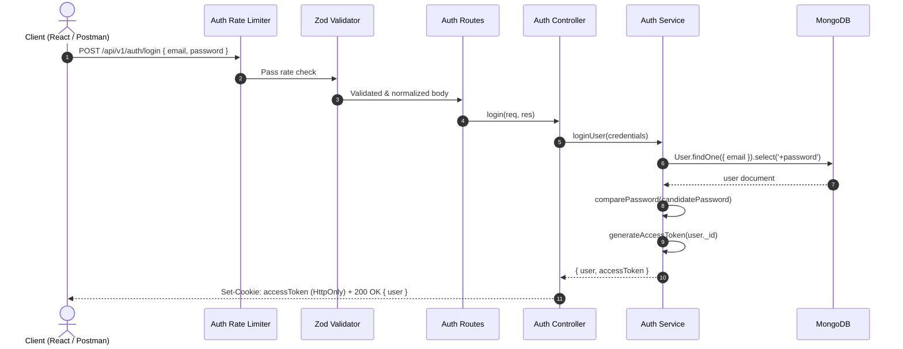

# Smart Hostel Management System

A modern, scalable Hostel Management System backend built with **Node.js**, **Express**, and **MongoDB (Mongoose)** featuring robust authentication, role-based access control (RBAC), Zod request schema validation, dedicated brute-force rate limiters, and structured database schemas for student accommodation workflows.

---

## Table of Contents

- [Overview](#overview)
- [Tech Stack](#tech-stack)
- [Project Architecture](#project-architecture)
- [Environment Variables](#environment-variables)
- [Getting Started](#getting-started)
  - [Prerequisites](#prerequisites)
  - [Installation](#installation)
  - [Running the Server](#running-the-server)
- [API Documentation & Sample Data](#api-documentation--sample-data)
  - [1. Health Check](#1-health-check)
  - [2. User Registration](#2-user-registration)
  - [3. User Login](#3-user-login)
  - [4. Profile Verification (Protected)](#4-profile-verification-protected)
  - [5. Role-Based Access Check (Warden / Admin)](#5-role-based-access-check-warden--admin)
- [Validation & Security Architecture](#validation--security-architecture)
  - [Request Validation with Zod](#request-validation-with-zod)
  - [Dedicated Authentication Rate Limiters](#dedicated-authentication-rate-limiters)
- [Authentication & Security Flow](#authentication--security-flow)
- [Git Branching Strategy](#git-branching-strategy)

---

## Overview

The Smart Hostel system automates and streamlines hostel administration tasks including:
- Student registration and secure authentication with schema validation.
- Role-based authorization (`student`, `warden`, `staff`, `admin`).
- Token handling using JSON Web Tokens (JWT) stored in HTTP-Only cookies.
- Comprehensive hostel modules: room allocation, complaints, fee payments, visitor logs, and official notice boards.

---

## Tech Stack

- **Runtime**: Node.js (ES Modules)
- **Framework**: Express.js
- **Database**: MongoDB with Mongoose ODM
- **Schema Validation**: Zod (`zod`)
- **Authentication**: JWT (`jsonwebtoken`) & password encryption with `bcryptjs` (12 salt rounds)
- **Security & Utilities**:
  - `helmet`: Security HTTP headers
  - `cors`: Cross-Origin Resource Sharing
  - `express-rate-limit`: Dedicated rate limiting against brute force & DoS
  - `cookie-parser`: Secure HTTP-only cookie parsing
  - `morgan`: HTTP request logging

---

## Project Architecture

```text
smart-hostel/
├── client/                     # Frontend application directory (React / Vite)
│   ├── src/
│   │   ├── components/
│   │   ├── hooks/
│   │   ├── layouts/
│   │   ├── pages/
│   │   └── services/
│   └── package.json
│
├── server/                     # Backend API service
│   ├── src/
│   │   ├── config/
│   │   │   ├── db.js           # MongoDB connection handler
│   │   │   └── env.js          # Environment variable parser & validator
│   │   ├── controllers/
│   │   │   └── auth.controller.js
│   │   ├── middlewares/
│   │   │   ├── auth.middleware.js          # JWT verification & req.user attachment
│   │   │   ├── authRateLimit.middleware.js # Dedicated registration & login rate limiters
│   │   │   ├── role.middleware.js          # Role-based authorization (RBAC)
│   │   │   ├── error.middleware.js         # Global error handling
│   │   │   ├── notFound.middleware.js      # 404 handler
│   │   │   └── validate.middleware.js      # Zod request validation middleware
│   │   ├── models/
│   │   │   ├── user.model.js
│   │   │   ├── hostel.model.js
│   │   │   ├── room.model.js
│   │   │   ├── bed.model.js
│   │   │   ├── allocation.model.js
│   │   │   ├── complaint.model.js
│   │   │   ├── fee.model.js
│   │   │   ├── payment.model.js
│   │   │   ├── notice.model.js
│   │   │   └── visitor.model.js
│   │   ├── routes/
│   │   │   └── auth.routes.js
│   │   ├── services/
│   │   │   ├── auth.service.js
│   │   │   └── user.service.js
│   │   ├── utils/
│   │   │   ├── ApiError.js
│   │   │   ├── asyncHandler.js
│   │   │   ├── response.js
│   │   │   └── tokens.js
│   │   ├── validators/
│   │   │   └── auth.validator.js           # Zod schemas for register & login
│   │   ├── app.js             # Express app setup and middleware configuration
│   │   └── server.js          # Application entrypoint & HTTP server listener
│   ├── .env.example
│   └── package.json
└── README.md
```

---

## Environment Variables

Configure the `.env` file in the `server/` directory:

```env
PORT=5001
MONGODB_URI=mongodb://127.0.0.1:27017/hostel_management
JWT_SECRET=your_super_secret_jwt_key_here
JWT_EXPIRES_IN=7d
CLIENT_URL=http://localhost:5173
NODE_ENV=development
```

> **Note on macOS**: Port `5001` is used by default because port `5000` is reserved by macOS AirPlay Receiver (`AirTunes`).

---

## Getting Started

### Prerequisites
- Node.js (v18+)
- MongoDB (running locally or MongoDB Atlas connection string)

### Installation

1. Clone repository:
   ```bash
   git clone https://github.com/shiv-pencia/SmartHostel-.git
   cd SmartHostel-
   ```

2. Install backend dependencies:
   ```bash
   cd server
   npm install
   ```

3. Ensure `.env` is set up with valid credentials in `server/.env`.

### Running the Server

- **Development Mode** (with automatic restart via nodemon):
  ```bash
  npm run dev
  ```
- **Production Mode**:
  ```bash
  npm start
  ```

---

## API Documentation & Sample Data

Base URL: `http://localhost:5001`

### 1. Health Check

Checks whether the API server is healthy and running.

- **Method**: `GET`
- **Route**: `/api/v1/health`
- **Authentication**: None

#### Sample Request
```bash
curl -X GET http://localhost:5001/api/v1/health
```

#### Sample Response (`200 OK`)
```json
{
  "success": true,
  "message": "Smart Hostel API is running",
  "environment": "development"
}
```

---

### 2. User Registration

Registers a new student account with Zod schema validation and registration rate limiting (5 attempts/hour).

- **Method**: `POST`
- **Route**: `/api/v1/auth/register`
- **Rate Limit**: 5 attempts per IP per hour (`registerLimiter`)
- **Validation**: Strict Zod schema (`registerSchema`)
- **Content-Type**: `application/json`

#### Request Body Schema
| Field | Type | Required | Constraints |
| :--- | :--- | :--- | :--- |
| `name` | String | Yes | 2 to 100 characters, trimmed |
| `email` | String | Yes | Valid email format, trimmed, lowercase |
| `password` | String | Yes | 8 to 128 characters, max 72 bytes |
| `phone` | String | No | 10 to 15 digits, optional `+` prefix |

#### Sample Request
```bash
curl -X POST http://localhost:5001/api/v1/auth/register \
  -H "Content-Type: application/json" \
  -d '{
    "name": "Shiv Prakash",
    "email": "shiv@example.com",
    "password": "password123",
    "phone": "+919876543210"
  }'
```

#### Sample Response (`201 Created`)
```json
{
  "success": true,
  "message": "Student registered successfully",
  "data": {
    "user": {
      "id": "6acb89cdcca5f3892ad245b6",
      "name": "Shiv Prakash",
      "email": "shiv@example.com",
      "phone": "+919876543210",
      "role": "student",
      "isActive": true,
      "lastLoginAt": null,
      "createdAt": "2026-10-11T13:06:21.334Z",
      "updatedAt": "2026-10-11T13:06:21.334Z"
    }
  }
}
```

#### Error Response (`400 Bad Request - Validation Failure`)
```json
{
  "success": false,
  "message": "Request validation failed",
  "errors": [
    {
      "field": "name",
      "message": "Name must have at least 2 characters"
    },
    {
      "field": "email",
      "message": "Invalid email address"
    },
    {
      "field": "password",
      "message": "Password must have at least 8 characters"
    }
  ]
}
```

#### Error Response (`409 Conflict - Duplicate Email`)
```json
{
  "success": false,
  "message": "Email is already registered"
}
```

---

### 3. User Login

Authenticates a user with login rate limiting and sets an `accessToken` HTTP-only cookie.

- **Method**: `POST`
- **Route**: `/api/v1/auth/login`
- **Rate Limit**: 10 failed attempts per IP per 15 mins (`loginLimiter`)
- **Validation**: Strict Zod schema (`loginSchema`)
- **Content-Type**: `application/json`

#### Request Body Schema
| Field | Type | Required | Constraints |
| :--- | :--- | :--- | :--- |
| `email` | String | Yes | Valid email format, trimmed, lowercase |
| `password` | String | Yes | 1 to 128 characters |

#### Sample Request
```bash
curl -i -X POST http://localhost:5001/api/v1/auth/login \
  -H "Content-Type: application/json" \
  -d '{
    "email": "shiv@example.com",
    "password": "password123"
  }'
```

#### Sample Response (`200 OK`)
```json
HTTP/1.1 200 OK
Set-Cookie: accessToken=eyJhbGciOiJIUzI1NiIsInR5cCI6IkpXVCJ9...; Max-Age=900; Path=/; HttpOnly; SameSite=Lax

{
  "success": true,
  "message": "Login successful",
  "data": {
    "user": {
      "id": "6acb89cdcca5f3892ad245b6",
      "name": "Shiv Prakash",
      "email": "shiv@example.com",
      "phone": "+919876543210",
      "role": "student",
      "isActive": true,
      "lastLoginAt": "2026-10-11T13:06:34.648Z",
      "createdAt": "2026-10-11T13:06:21.334Z",
      "updatedAt": "2026-10-11T13:06:34.648Z"
    }
  }
}
```

#### Error Response (`401 Unauthorized`)
```json
{
  "success": false,
  "message": "Invalid email or password"
}
```

#### Error Response (`429 Too Many Requests`)
```json
{
  "success": false,
  "message": "Too many requests. Please try again later."
}
```

---

### 4. Profile Verification (Protected)

Verifies the user's active session using the `accessToken` cookie.

- **Method**: `GET`
- **Route**: `/api/v1/auth/profile-check`
- **Authentication**: Required (`accessToken` Cookie)

#### Sample Request (with Cookie)
```bash
curl -X GET http://localhost:5001/api/v1/auth/profile-check \
  --cookie "accessToken=eyJhbGciOiJIUzI1NiIsInR5cCI6IkpXVCJ9..."
```

#### Sample Response (`200 OK`)
```json
{
  "success": true,
  "message": "Authentication successful",
  "data": {
    "user": {
      "id": "6acb89cdcca5f3892ad245b6",
      "name": "Shiv Prakash",
      "email": "shiv@example.com",
      "phone": "+919876543210",
      "role": "student",
      "isActive": true,
      "lastLoginAt": "2026-10-11T13:06:34.648Z",
      "createdAt": "2026-10-11T13:06:21.334Z",
      "updatedAt": "2026-10-11T13:06:34.648Z"
    }
  }
}
```

#### Error Response (`401 Unauthorized - No Cookie`)
```json
{
  "success": false,
  "message": "Authentication required. Please login."
}
```

---

### 5. Role-Based Access Check (Warden / Admin)

Validates whether the authenticated user has administrative or warden privileges.

- **Method**: `GET`
- **Route**: `/api/v1/auth/warden-check`
- **Authentication**: Required (`role: "admin"` or `"warden"`)

#### Error Response (`403 Forbidden - Role Not Permitted`)
```json
{
  "success": false,
  "message": "You do not have permission to access this resource"
}
```

---

## Validation & Security Architecture

### Request Validation with Zod

The application uses **Zod** (`zod`) schemas wrapped by [`validate.middleware.js`](file:///Users/shivprakash/Desktop/DBMS_PROJECT/smart-hostel/server/src/middlewares/validate.middleware.js) to enforce strict request validation:
- Input sanitization (`trim`, `toLowerCase`)
- Field type and boundary enforcement (`min`, `max`, `regex`)
- Bcrypt password limit enforcement (max 72 bytes)
- Unknown fields rejection via `z.strictObject()`
- Standardized error format returning `field` and `message` list

### Dedicated Authentication Rate Limiters

Configured in [`authRateLimit.middleware.js`](file:///Users/shivprakash/Desktop/DBMS_PROJECT/smart-hostel/server/src/middlewares/authRateLimit.middleware.js):
- **Registration Limiter**: 5 requests / IP / hour (prevents bot account creation spam).
- **Login Limiter**: 10 failed requests / IP / 15 minutes with `skipSuccessfulRequests: true` (prevents brute-force credential stuffing while not penalizing legitimate logins).

---

## Authentication & Security Flow



---

## Git Branching Strategy

The repository follows a multi-branch team collaboration structure:

| Branch | Purpose |
| :--- | :--- |
| **`main`** | Production-ready stable release branch |
| **`shiv`** | Shiv's active development branch |
| **`prinjam`** | Prinjam's feature branch |
| **`sourabh`** | Sourabh's feature branch |
